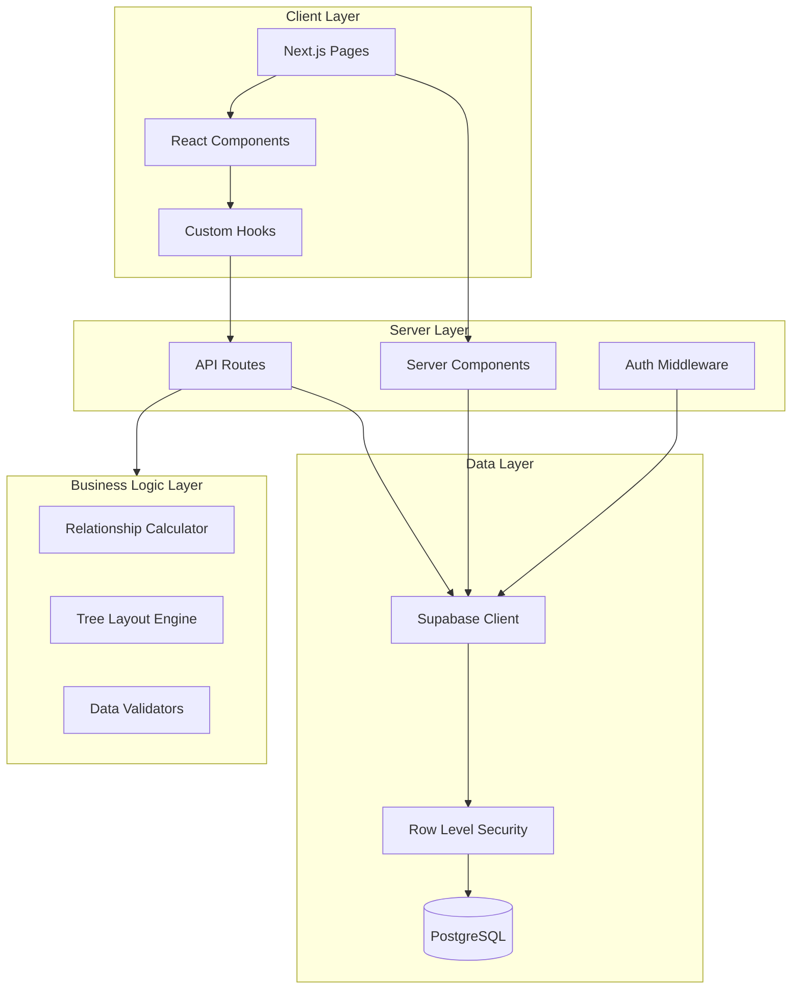
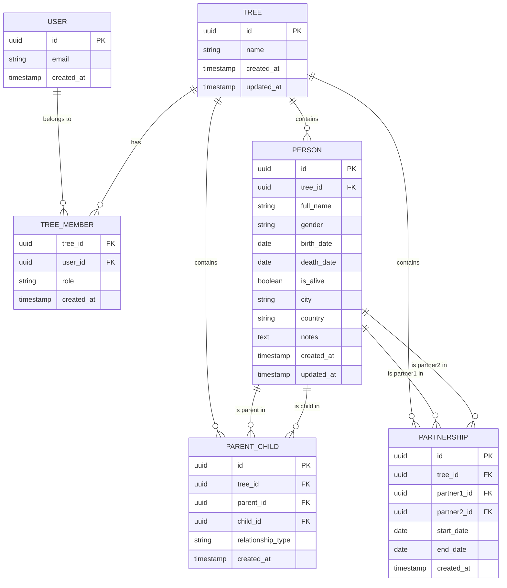

# Technical Design Document: Family Tree MVP

## Overview

This document describes the technical architecture for a multi-tenant family tree SaaS application. The system enables users to authenticate, create and manage family tree data, visualize relationships through an interactive graph, and analyze connections between family members.

### Core Design Principles

1. **Primitive Facts Only**: Store only basic entities (person, parent_child, partnership). Derive all relationships (cousin, uncle, etc.) computationally.
2. **Multi-Tenancy**: Every data table includes `tree_id` for tenant isolation. All queries automatically scope to the user's tree.
3. **Row-Level Security**: Use Supabase RLS to enforce data isolation at the database level.
4. **Pure Business Logic**: Keep all relationship computation and business rules in `/lib` as pure, testable functions.
5. **Thin API Layer**: API route handlers only orchestrate data flow; they don't contain business logic.
6. **Type Safety**: Strict TypeScript throughout the application with comprehensive type definitions.

### Technology Stack

- **Framework**: Next.js 14+ with App Router
- **Language**: TypeScript (strict mode)
- **Styling**: Tailwind CSS + shadcn/ui components
- **Database**: Supabase (PostgreSQL + Auth)
- **Visualization**: React Flow for tree graph rendering
- **Testing**: Vitest for unit tests

---

## Architecture

### System Architecture Diagram



### Architecture Layers

#### 1. Client Layer
- **Pages**: Next.js App Router pages (both Server and Client Components)
- **Components**: Reusable React components (shadcn/ui + custom)
- **Hooks**: Custom React hooks for data fetching and state management

#### 2. Server Layer
- **API Routes**: Thin handlers for CRUD operations
- **Server Components**: Data-fetching components with direct database access
- **Middleware**: Authentication and authorization checks

#### 3. Business Logic Layer (Pure Functions in `/lib`)
- **Relationship Calculator**: Computes family relationships between any two people
- **Tree Layout Engine**: Calculates node positions for React Flow visualization
- **Validators**: Input validation and business rule enforcement

#### 4. Data Layer
- **Supabase Client**: Configured client with auth context
- **RLS Policies**: Database-level access control
- **PostgreSQL**: Primary data store

---

## Components and Interfaces

### Directory Structure

```
app/
├── (auth)/
│   ├── login/
│   │   └── page.tsx              # Login/signup page
│   └── layout.tsx                # Auth layout (no sidebar)
├── (protected)/
│   ├── dashboard/
│   │   └── page.tsx              # Dashboard page
│   ├── people/
│   │   ├── page.tsx              # People list with search/filter
│   │   ├── [id]/
│   │   │   └── page.tsx          # Person detail page
│   │   └── components/
│   │       ├── person-form.tsx   # Add/edit person modal
│   │       ├── person-table.tsx  # Sortable, filterable table
│   │       └── parent-selector.tsx
│   ├── tree/
│   │   └── page.tsx              # React Flow tree visualization
│   ├── related/
│   │   └── page.tsx              # Relationship analysis tool
│   ├── stats/
│   │   └── page.tsx              # Statistics dashboard
│   ├── layout.tsx                # Protected layout with sidebar
│   └── components/
│       └── sidebar.tsx           # Navigation sidebar
├── api/
│   ├── auth/
│   │   ├── callback/route.ts     # OAuth callback handler
│   │   └── logout/route.ts       # Logout handler
│   └── people/
│       ├── route.ts              # GET (list), POST (create)
│       └── [id]/route.ts         # GET, PATCH, DELETE
├── page.tsx                      # Public landing page
├── layout.tsx                    # Root layout
└── providers.tsx                 # Client-side providers

components/
├── ui/                           # shadcn/ui components
│   ├── button.tsx
│   ├── input.tsx
│   ├── dialog.tsx
│   ├── select.tsx
│   ├── table.tsx
│   └── ... (other shadcn components)
└── theme-provider.tsx            # Theme context provider

lib/
├── supabase/
│   ├── client.ts                 # Browser client
│   ├── server.ts                 # Server client with cookies
│   └── middleware.ts             # Auth middleware
├── relationships/
│   ├── calculator.ts             # Core relationship algorithm
│   ├── path-finder.ts            # Find paths between people
│   └── labels.ts                 # Generate relationship labels
├── tree/
│   ├── layout.ts                 # Calculate React Flow node positions
│   └── types.ts                  # Tree visualization types
├── validators/
│   ├── person.ts                 # Person data validation
│   └── relationship.ts           # Relationship validation
├── db/
│   ├── types.ts                  # Database TypeScript types
│   └── queries.ts                # Reusable query builders
└── utils.ts                      # General utilities

types/
├── database.ts                   # Generated Supabase types
├── person.ts                     # Person domain types
└── relationship.ts               # Relationship domain types
```

### Key Components

#### 1. Authentication Components

**LoginForm** (`app/(auth)/login/components/login-form.tsx`)
```typescript
interface LoginFormProps {
  redirectTo?: string;
}

// Handles email/password and Google OAuth
// Shows loading states, error messages
// Redirects to dashboard or original destination on success
```

#### 2. Protected Layout Components

**Sidebar** (`app/(protected)/components/sidebar.tsx`)
```typescript
interface SidebarProps {
  user: User;
}

// Navigation links: Dashboard, People, Tree, Related, Stats
// Shows user email and logout button
// Responsive: hamburger menu on mobile
// Theme toggle control
```

**MobileMenuButton** (part of Sidebar)
```typescript
// Toggles sidebar visibility on mobile viewports
```

#### 3. People Management Components

**PersonTable** (`app/(protected)/people/components/person-table.tsx`)
```typescript
interface PersonTableProps {
  people: Person[];
  onEdit: (person: Person) => void;
  onDelete: (personId: string) => void;
}

// Sortable columns: name, birth date, city, country
// Inline edit and delete actions
// Responsive layout
```

**PersonForm** (`app/(protected)/people/components/person-form.tsx`)
```typescript
interface PersonFormProps {
  person?: Person; // undefined for create, populated for edit
  onSubmit: (data: PersonInput) => Promise<void>;
  onCancel: () => void;
}

// Input fields: full_name, gender, birth_date, death_date, 
//               is_alive, city, country, notes
// Parent selector (max 2 parents)
// Validation: required fields, date logic, duplicate names
```

**ParentSelector** (`app/(protected)/people/components/parent-selector.tsx`)
```typescript
interface ParentSelectorProps {
  selectedParents: ParentRelationship[];
  availablePeople: Person[];
  onChange: (parents: ParentRelationship[]) => void;
}

interface ParentRelationship {
  personId: string;
  relationshipType: 'biological' | 'adopted' | 'step';
}

// Max 2 parents
// Dropdown to select person + relationship type
```

**SearchAndFilter** (`app/(protected)/people/components/search-filter.tsx`)
```typescript
interface SearchAndFilterProps {
  onSearchChange: (query: string) => void;
  onFilterChange: (filters: PersonFilters) => void;
}

interface PersonFilters {
  gender?: string;
  isAlive?: boolean;
  city?: string;
  country?: string;
}

// Debounced search input (300ms)
// Filter dropdowns for gender, status, location
```

#### 4. Person Detail Components

**PersonDetail** (`app/(protected)/people/[id]/page.tsx`)
```typescript
// Server Component that fetches:
// - Person data
// - Parents with relationship types
// - Partners
// - Children (grouped by partner)
// - Siblings (full vs half)
// - Computed relationship to logged-in user

// Sections: Bio, Parents, Partners, Children, Siblings
// Edit button opens PersonForm modal
// All names link to respective detail pages
```

#### 5. Tree Visualization Components

**TreeView** (`app/(protected)/tree/page.tsx`)
```typescript
// Client Component using React Flow
// Fetches all people and relationships
// Calculates layout using lib/tree/layout.ts
// Node click navigates to person detail
// Zoom and pan controls
// Visual indicator for deceased (border/icon)
```

**PersonNode** (custom React Flow node)
```typescript
interface PersonNodeData {
  person: Person;
  isDeceased: boolean;
}

// Custom node component for React Flow
// Displays full_name
// Styling based on deceased status
// Click handler for navigation
```

#### 6. Relationship Analysis Components

**RelationshipAnalyzer** (`app/(protected)/related/page.tsx`)
```typescript
// Two person picker dropdowns
// Searchable, filterable by name
// Displays computed relationship label
// Shows path between people with intermediate nodes
// Lists common ancestors
```

#### 7. Statistics Components

**StatsCards** (`app/(protected)/stats/page.tsx`)
```typescript
// Cards showing:
// - Total members
// - Alive count
// - Deceased count
// - Top 5 countries
// - Top 5 cities
// - Oldest ancestor (name + birth year)
// - Recent additions (last 10, with relative timestamps)

// Empty state: link to people page
```

#### 8. Theme Components

**ThemeProvider** (`components/theme-provider.tsx`)
```typescript
interface ThemeProviderProps {
  children: React.ReactNode;
  defaultTheme?: 'light' | 'dark';
}

// Wraps app in theme context
// Reads from localStorage on init
// Provides toggle function
// Persists theme preference
```

---

## Data Models

### Database Schema

#### Tables Overview



#### Table Definitions

**1. tree**
```sql
CREATE TABLE tree (
  id UUID PRIMARY KEY DEFAULT gen_random_uuid(),
  name TEXT NOT NULL,
  created_at TIMESTAMPTZ NOT NULL DEFAULT NOW(),
  updated_at TIMESTAMPTZ NOT NULL DEFAULT NOW()
);

-- Index for lookups
CREATE INDEX idx_tree_created_at ON tree(created_at);
```

**2. tree_member**
```sql
CREATE TABLE tree_member (
  tree_id UUID NOT NULL REFERENCES tree(id) ON DELETE CASCADE,
  user_id UUID NOT NULL REFERENCES auth.users(id) ON DELETE CASCADE,
  role TEXT NOT NULL CHECK (role IN ('owner', 'editor', 'viewer')),
  created_at TIMESTAMPTZ NOT NULL DEFAULT NOW(),
  PRIMARY KEY (tree_id, user_id)
);

-- Indexes for access checks
CREATE INDEX idx_tree_member_user_id ON tree_member(user_id);
CREATE INDEX idx_tree_member_tree_id ON tree_member(tree_id);
```

**3. person**
```sql
CREATE TABLE person (
  id UUID PRIMARY KEY DEFAULT gen_random_uuid(),
  tree_id UUID NOT NULL REFERENCES tree(id) ON DELETE CASCADE,
  full_name TEXT NOT NULL,
  gender TEXT CHECK (gender IN ('Male', 'Female', 'Other', 'Prefer not to say')),
  birth_date DATE,
  death_date DATE,
  is_alive BOOLEAN NOT NULL DEFAULT TRUE,
  city TEXT,
  country TEXT,
  notes TEXT,
  created_at TIMESTAMPTZ NOT NULL DEFAULT NOW(),
  updated_at TIMESTAMPTZ NOT NULL DEFAULT NOW(),
  
  -- Constraints
  CONSTRAINT birth_before_death CHECK (birth_date IS NULL OR death_date IS NULL OR birth_date <= death_date)
);

-- Indexes for queries
CREATE INDEX idx_person_tree_id ON person(tree_id);
CREATE INDEX idx_person_full_name ON person(tree_id, full_name);
CREATE INDEX idx_person_city ON person(tree_id, city) WHERE city IS NOT NULL;
CREATE INDEX idx_person_country ON person(tree_id, country) WHERE country IS NOT NULL;
CREATE INDEX idx_person_is_alive ON person(tree_id, is_alive);
CREATE INDEX idx_person_birth_date ON person(tree_id, birth_date) WHERE birth_date IS NOT NULL;
CREATE INDEX idx_person_created_at ON person(tree_id, created_at);
```

**4. parent_child**
```sql
CREATE TABLE parent_child (
  id UUID PRIMARY KEY DEFAULT gen_random_uuid(),
  tree_id UUID NOT NULL REFERENCES tree(id) ON DELETE CASCADE,
  parent_id UUID NOT NULL REFERENCES person(id) ON DELETE CASCADE,
  child_id UUID NOT NULL REFERENCES person(id) ON DELETE CASCADE,
  relationship_type TEXT NOT NULL CHECK (relationship_type IN ('biological', 'adopted', 'step')),
  created_at TIMESTAMPTZ NOT NULL DEFAULT NOW(),
  
  -- Constraints
  CONSTRAINT no_self_parent CHECK (parent_id != child_id),
  CONSTRAINT unique_parent_child UNIQUE (parent_id, child_id)
);

-- Indexes for relationship queries
CREATE INDEX idx_parent_child_tree_id ON parent_child(tree_id);
CREATE INDEX idx_parent_child_parent_id ON parent_child(parent_id);
CREATE INDEX idx_parent_child_child_id ON parent_child(child_id);

-- Function to enforce max 2 parents
CREATE OR REPLACE FUNCTION check_max_parents()
RETURNS TRIGGER AS $$
BEGIN
  IF (SELECT COUNT(*) FROM parent_child WHERE child_id = NEW.child_id) >= 2 THEN
    RAISE EXCEPTION 'A person cannot have more than 2 parents';
  END IF;
  RETURN NEW;
END;
$$ LANGUAGE plpgsql;

CREATE TRIGGER enforce_max_parents
  BEFORE INSERT ON parent_child
  FOR EACH ROW
  EXECUTE FUNCTION check_max_parents();
```

**5. partnership**
```sql
CREATE TABLE partnership (
  id UUID PRIMARY KEY DEFAULT gen_random_uuid(),
  tree_id UUID NOT NULL REFERENCES tree(id) ON DELETE CASCADE,
  partner1_id UUID NOT NULL REFERENCES person(id) ON DELETE CASCADE,
  partner2_id UUID NOT NULL REFERENCES person(id) ON DELETE CASCADE,
  start_date DATE,
  end_date DATE,
  created_at TIMESTAMPTZ NOT NULL DEFAULT NOW(),
  
  -- Constraints
  CONSTRAINT no_self_partnership CHECK (partner1_id != partner2_id),
  CONSTRAINT unique_partnership UNIQUE (partner1_id, partner2_id),
  CONSTRAINT start_before_end CHECK (start_date IS NULL OR end_date IS NULL OR start_date <= end_date)
);

-- Indexes for relationship queries
CREATE INDEX idx_partnership_tree_id ON partnership(tree_id);
CREATE INDEX idx_partnership_partner1_id ON partnership(partner1_id);
CREATE INDEX idx_partnership_partner2_id ON partnership(partner2_id);
```

### Row-Level Security Policies

**Helper Function: Check Tree Access**
```sql
CREATE OR REPLACE FUNCTION has_tree_access(p_tree_id UUID)
RETURNS BOOLEAN AS $$
BEGIN
  RETURN EXISTS (
    SELECT 1 FROM tree_member
    WHERE tree_id = p_tree_id
    AND user_id = auth.uid()
  );
END;
$$ LANGUAGE plpgsql SECURITY DEFINER;

CREATE OR REPLACE FUNCTION get_user_role(p_tree_id UUID)
RETURNS TEXT AS $$
BEGIN
  RETURN (
    SELECT role FROM tree_member
    WHERE tree_id = p_tree_id
    AND user_id = auth.uid()
  );
END;
$$ LANGUAGE plpgsql SECURITY DEFINER;
```

**RLS Policies for `tree` table**
```sql
ALTER TABLE tree ENABLE ROW LEVEL SECURITY;

-- Users can see trees they're members of
CREATE POLICY "Users can view their trees"
  ON tree FOR SELECT
  USING (
    EXISTS (
      SELECT 1 FROM tree_member
      WHERE tree_member.tree_id = tree.id
      AND tree_member.user_id = auth.uid()
    )
  );

-- Only authenticated users can create trees (handled in signup logic)
CREATE POLICY "Authenticated users can create trees"
  ON tree FOR INSERT
  WITH CHECK (auth.uid() IS NOT NULL);

-- Only owners can update trees
CREATE POLICY "Owners can update their trees"
  ON tree FOR UPDATE
  USING (
    EXISTS (
      SELECT 1 FROM tree_member
      WHERE tree_member.tree_id = tree.id
      AND tree_member.user_id = auth.uid()
      AND tree_member.role = 'owner'
    )
  );

-- Only owners can delete trees
CREATE POLICY "Owners can delete their trees"
  ON tree FOR DELETE
  USING (
    EXISTS (
      SELECT 1 FROM tree_member
      WHERE tree_member.tree_id = tree.id
      AND tree_member.user_id = auth.uid()
      AND tree_member.role = 'owner'
    )
  );
```

**RLS Policies for `tree_member` table**
```sql
ALTER TABLE tree_member ENABLE ROW LEVEL SECURITY;

-- Users can see all members of trees they belong to
CREATE POLICY "Users can view members of their trees"
  ON tree_member FOR SELECT
  USING (
    EXISTS (
      SELECT 1 FROM tree_member tm
      WHERE tm.tree_id = tree_member.tree_id
      AND tm.user_id = auth.uid()
    )
  );

-- Only owners can add members
CREATE POLICY "Owners can add members"
  ON tree_member FOR INSERT
  WITH CHECK (
    EXISTS (
      SELECT 1 FROM tree_member tm
      WHERE tm.tree_id = tree_member.tree_id
      AND tm.user_id = auth.uid()
      AND tm.role = 'owner'
    )
  );

-- Only owners can update member roles
CREATE POLICY "Owners can update member roles"
  ON tree_member FOR UPDATE
  USING (
    EXISTS (
      SELECT 1 FROM tree_member tm
      WHERE tm.tree_id = tree_member.tree_id
      AND tm.user_id = auth.uid()
      AND tm.role = 'owner'
    )
  );

-- Only owners can remove members
CREATE POLICY "Owners can remove members"
  ON tree_member FOR DELETE
  USING (
    EXISTS (
      SELECT 1 FROM tree_member tm
      WHERE tm.tree_id = tree_member.tree_id
      AND tm.user_id = auth.uid()
      AND tm.role = 'owner'
    )
  );
```

**RLS Policies for `person` table**
```sql
ALTER TABLE person ENABLE ROW LEVEL SECURITY;

-- Users can view people in their trees
CREATE POLICY "Users can view people in their trees"
  ON person FOR SELECT
  USING (has_tree_access(tree_id));

-- Editors and owners can create people
CREATE POLICY "Editors can create people"
  ON person FOR INSERT
  WITH CHECK (
    has_tree_access(tree_id) AND
    get_user_role(tree_id) IN ('editor', 'owner')
  );

-- Editors and owners can update people
CREATE POLICY "Editors can update people"
  ON person FOR UPDATE
  USING (
    has_tree_access(tree_id) AND
    get_user_role(tree_id) IN ('editor', 'owner')
  );

-- Editors and owners can delete people (if no relationships exist)
CREATE POLICY "Editors can delete people"
  ON person FOR DELETE
  USING (
    has_tree_access(tree_id) AND
    get_user_role(tree_id) IN ('editor', 'owner')
  );
```

**RLS Policies for `parent_child` table**
```sql
ALTER TABLE parent_child ENABLE ROW LEVEL SECURITY;

-- Users can view relationships in their trees
CREATE POLICY "Users can view relationships in their trees"
  ON parent_child FOR SELECT
  USING (has_tree_access(tree_id));

-- Editors can create relationships
CREATE POLICY "Editors can create relationships"
  ON parent_child FOR INSERT
  WITH CHECK (
    has_tree_access(tree_id) AND
    get_user_role(tree_id) IN ('editor', 'owner')
  );

-- Editors can update relationships
CREATE POLICY "Editors can update relationships"
  ON parent_child FOR UPDATE
  USING (
    has_tree_access(tree_id) AND
    get_user_role(tree_id) IN ('editor', 'owner')
  );

-- Editors can delete relationships
CREATE POLICY "Editors can delete relationships"
  ON parent_child FOR DELETE
  USING (
    has_tree_access(tree_id) AND
    get_user_role(tree_id) IN ('editor', 'owner')
  );
```

**RLS Policies for `partnership` table**
```sql
ALTER TABLE partnership ENABLE ROW LEVEL SECURITY;

-- Users can view partnerships in their trees
CREATE POLICY "Users can view partnerships in their trees"
  ON partnership FOR SELECT
  USING (has_tree_access(tree_id));

-- Editors can create partnerships
CREATE POLICY "Editors can create partnerships"
  ON partnership FOR INSERT
  WITH CHECK (
    has_tree_access(tree_id) AND
    get_user_role(tree_id) IN ('editor', 'owner')
  );

-- Editors can update partnerships
CREATE POLICY "Editors can update partnerships"
  ON partnership FOR UPDATE
  USING (
    has_tree_access(tree_id) AND
    get_user_role(tree_id) IN ('editor', 'owner')
  );

-- Editors can delete partnerships
CREATE POLICY "Editors can delete partnerships"
  ON partnership FOR DELETE
  USING (
    has_tree_access(tree_id) AND
    get_user_role(tree_id) IN ('editor', 'owner')
  );
```

### TypeScript Type Definitions

**Database Types** (`types/database.ts`)
```typescript
// Generated by Supabase CLI: supabase gen types typescript

export type Json =
  | string
  | number
  | boolean
  | null
  | { [key: string]: Json | undefined }
  | Json[]

export interface Database {
  public: {
    Tables: {
      tree: {
        Row: {
          id: string
          name: string
          created_at: string
          updated_at: string
        }
        Insert: {
          id?: string
          name: string
          created_at?: string
          updated_at?: string
        }
        Update: {
          id?: string
          name?: string
          updated_at?: string
        }
      }
      tree_member: {
        Row: {
          tree_id: string
          user_id: string
          role: 'owner' | 'editor' | 'viewer'
          created_at: string
        }
        Insert: {
          tree_id: string
          user_id: string
          role: 'owner' | 'editor' | 'viewer'
          created_at?: string
        }
        Update: {
          role?: 'owner' | 'editor' | 'viewer'
        }
      }
      person: {
        Row: {
          id: string
          tree_id: string
          full_name: string
          gender: 'Male' | 'Female' | 'Other' | 'Prefer not to say' | null
          birth_date: string | null
          death_date: string | null
          is_alive: boolean
          city: string | null
          country: string | null
          notes: string | null
          created_at: string
          updated_at: string
        }
        Insert: {
          id?: string
          tree_id: string
          full_name: string
          gender?: 'Male' | 'Female' | 'Other' | 'Prefer not to say' | null
          birth_date?: string | null
          death_date?: string | null
          is_alive?: boolean
          city?: string | null
          country?: string | null
          notes?: string | null
          created_at?: string
          updated_at?: string
        }
        Update: {
          full_name?: string
          gender?: 'Male' | 'Female' | 'Other' | 'Prefer not to say' | null
          birth_date?: string | null
          death_date?: string | null
          is_alive?: boolean
          city?: string | null
          country?: string | null
          notes?: string | null
          updated_at?: string
        }
      }
      parent_child: {
        Row: {
          id: string
          tree_id: string
          parent_id: string
          child_id: string
          relationship_type: 'biological' | 'adopted' | 'step'
          created_at: string
        }
        Insert: {
          id?: string
          tree_id: string
          parent_id: string
          child_id: string
          relationship_type: 'biological' | 'adopted' | 'step'
          created_at?: string
        }
        Update: {
          relationship_type?: 'biological' | 'adopted' | 'step'
        }
      }
      partnership: {
        Row: {
          id: string
          tree_id: string
          partner1_id: string
          partner2_id: string
          start_date: string | null
          end_date: string | null
          created_at: string
        }
        Insert: {
          id?: string
          tree_id: string
          partner1_id: string
          partner2_id: string
          start_date?: string | null
          end_date?: string | null
          created_at?: string
        }
        Update: {
          start_date?: string | null
          end_date?: string | null
        }
      }
    }
  }
}
```

**Domain Types** (`types/person.ts`)
```typescript
export interface Person {
  id: string
  treeId: string
  fullName: string
  gender: Gender | null
  birthDate: Date | null
  deathDate: Date | null
  isAlive: boolean
  city: string | null
  country: string | null
  notes: string | null
  createdAt: Date
  updatedAt: Date
}

export type Gender = 'Male' | 'Female' | 'Other' | 'Prefer not to say'

export interface PersonWithRelationships extends Person {
  parents: PersonParent[]
  partners: PersonPartner[]
  children: PersonChild[]
  siblings: PersonSibling[]
}

export interface PersonParent {
  id: string
  fullName: string
  relationshipType: RelationshipType
}

export interface PersonPartner {
  id: string
  fullName: string
  startDate: Date | null
  endDate: Date | null
}

export interface PersonChild {
  id: string
  fullName: string
  relationshipType: RelationshipType
  partnerId: string | null  // Which partner is the co-parent
}

export interface PersonSibling {
  id: string
  fullName: string
  type: 'full' | 'half'  // Full = same parents, half = one shared parent
  sharedParents: string[]  // IDs of shared parents
}

export type RelationshipType = 'biological' | 'adopted' | 'step'

export interface PersonInput {
  fullName: string
  gender?: Gender | null
  birthDate?: Date | null
  deathDate?: Date | null
  isAlive: boolean
  city?: string | null
  country?: string | null
  notes?: string | null
  parents?: {
    personId: string
    relationshipType: RelationshipType
  }[]
}

export interface PersonFilters {
  search?: string
  gender?: Gender
  isAlive?: boolean
  city?: string
  country?: string
}
```

**Relationship Types** (`types/relationship.ts`)
```typescript
export type ComputedRelationship =
  | 'self'
  | 'parent'
  | 'child'
  | 'sibling'
  | 'grandparent'
  | 'grandchild'
  | 'aunt-uncle'
  | 'niece-nephew'
  | 'cousin'
  | 'spouse-partner'
  | 'not-related'

export interface RelationshipLabel {
  label: string  // e.g., "your grandmother", "your first cousin"
  type: ComputedRelationship
  distance: number  // Genealogical distance
}

export interface RelationshipPath {
  person1: Person
  person2: Person
  path: Person[]  // Intermediate people in the path
  commonAncestors: Person[]
  relationship: RelationshipLabel
}

export interface CousinRelationship {
  degree: number  // 1 = first cousin, 2 = second cousin, etc.
  removed: number  // 0 = same generation, 1 = once removed, etc.
}

// Graph representation for relationship computation
export interface FamilyGraph {
  nodes: Map<string, Person>  // personId -> Person
  parentEdges: Map<string, string[]>  // personId -> parent IDs
  childEdges: Map<string, string[]>  // personId -> child IDs
  partnerEdges: Map<string, string[]>  // personId -> partner IDs
}
```

---

## Correctness Properties

*A property is a characteristic or behavior that should hold true across all valid executions of a system—essentially, a formal statement about what the system should do. Properties serve as the bridge between human-readable specifications and machine-verifiable correctness guarantees.*

### Property 1: Email Validation Correctness

*For any* string input, the email validator SHALL accept it if and only if it is between 1 and 254 characters AND contains an @ symbol.

**Validates: Requirements 2.2**

### Property 2: Password Validation Correctness

*For any* string input, the password validator SHALL reject it if and only if its length is less than 8 characters.

**Validates: Requirements 2.3**

### Property 3: Birth Death Date Ordering

*For any* person record with both birth_date and death_date populated, the validator SHALL reject it if and only if birth_date is after death_date.

**Validates: Requirements 8.14**

### Property 4: Maximum Parents Constraint

*For any* list of parent relationships for a person, the validator SHALL reject it if and only if the count exceeds 2.

**Validates: Requirements 8.24**

### Property 5: Sibling Classification Correctness

*For any* two people A and B where both have parents defined, they SHALL be classified as full siblings if they share both parents, half siblings if they share exactly one parent, and not siblings if they share no parents.

**Validates: Requirements 9.14**

### Property 6: Relationship Calculation for Direct Ancestors

*For any* person A and person B where a parent-child path exists from B to A going up N generations, the relationship from A's perspective SHALL be "grandparent" with N-1 "great-" prefixes, using gender-appropriate terms (grandfather/grandmother).

**Validates: Requirements 9.18, 11.13, 11.14**

### Property 7: Relationship Calculation for Direct Descendants

*For any* person A and person B where a parent-child path exists from A to B going down N generations, the relationship from A's perspective SHALL be "grandchild" with N-1 "great-" prefixes, using gender-appropriate terms (grandson/granddaughter).

**Validates: Requirements 9.21, 11.13, 11.14**

### Property 8: Sibling Relationship Labels

*For any* two people who share at least one parent, the relationship SHALL be labeled "brother" or "sister" (for full siblings) or "half-brother" or "half-sister" (for half siblings), using the appropriate gender term for the target person.

**Validates: Requirements 9.19, 11.15, 11.16**

### Property 9: Cousin Relationship Calculation

*For any* two people A and B who share a common ancestor N generations up from A and M generations up from B (where N, M ≥ 2), they SHALL be classified as cousins where the degree is min(N,M)-1 and "removed" count is |N-M|.

**Validates: Requirements 9.24, 11.18, 11.19, 11.20, 11.21**

### Property 10: Relationship Symmetry (Inverse Relationships)

*For any* two people A and B, if the relationship from A to B is "grandmother", then the relationship from B to A SHALL be "grandchild" (with appropriate gender terms). More generally, ancestor/descendant, aunt-uncle/niece-nephew, and cousin relationships SHALL have correct inverses.

**Validates: Requirements 9.15, 9.16, 9.17, 9.18, 9.19, 9.20, 9.21, 9.22, 9.23, 9.24, 9.25, 9.26, 11.12, 11.13, 11.14, 11.15, 11.16, 11.17, 11.18, 11.19, 11.20, 11.21, 11.22**

### Property 11: Path Existence in Connected Components

*For any* two people A and B in the same connected component of the family graph, a relationship path SHALL exist between them. For any two people in different connected components, the relationship SHALL be "not related".

**Validates: Requirements 11.10, 11.23**

### Property 12: Shortest Relationship Path

*For any* two people with multiple relationship paths between them, the relationship calculator SHALL return the closest relationship (shortest genealogical distance).

**Validates: Requirements 11.26**

### Property 13: Ancestor Layout Invariant

*For any* person A who is an ancestor of person B, after the tree layout algorithm runs, person A SHALL have a Y-coordinate less than person B's Y-coordinate (ancestors positioned above descendants).

**Validates: Requirements 10.8, 10.9**

### Property 14: Partnership Layout Invariant

*For any* two people in a partnership relationship, after the tree layout algorithm runs, they SHALL have Y-coordinates within a small threshold (same generation level) and be positioned horizontally near each other.

**Validates: Requirements 10.10**

### Property 15: No Self-Relationships

*For any* validation of parent-child or partnership relationships, the validator SHALL reject any relationship where both IDs refer to the same person.

**Validates: Requirements 8.24, 16.1, 16.2, 16.3**

---

## Error Handling

### Error Classification

The application handles errors at multiple layers, each with specific strategies:

#### 1. Client-Side Validation Errors
- **Input Validation**: Form inputs are validated before submission
- **Display Strategy**: Inline error messages below the relevant field
- **User Actions**: Users can correct input without losing context
- **Examples**: Empty required fields, invalid email format, birth date after death date

#### 2. Authentication Errors
- **Auth Provider Errors**: Network issues, invalid credentials, OAuth failures
- **Display Strategy**: Error banner at top of login form with specific message
- **User Actions**: Retry button, option to use alternative auth method
- **Timeout Handling**: 30-second timeout with clear error message
- **Examples**: "Invalid email or password", "OAuth provider unavailable"

#### 3. Database Errors
- **RLS Policy Violations**: User attempting to access data from another tree
- **Constraint Violations**: Duplicate unique keys, foreign key violations, check constraint failures
- **Display Strategy**: Toast notification with user-friendly message (technical details logged)
- **User Actions**: Reload page, contact support for persistent issues
- **Examples**: "Cannot add more than 2 parents", "Cannot delete person with existing relationships"

#### 4. Network Errors
- **Connection Issues**: Request timeout, no internet connection, server unavailable
- **Display Strategy**: Error page with retry button (for full page loads) or toast notification (for async operations)
- **Retry Strategy**: Automatic retry with exponential backoff for transient failures
- **User Actions**: Retry button, check connection message
- **Examples**: "Failed to load data", "Connection timeout"

#### 5. Business Logic Errors
- **Relationship Calculation Failures**: Circular references, corrupted graph data
- **Display Strategy**: Fallback to "Unable to determine relationship" with option to report issue
- **Logging**: Full error context logged for debugging
- **User Actions**: Continue using other features, report issue
- **Examples**: "Cannot calculate relationship", "Invalid family graph structure"

### Error Handling Patterns by Component

#### API Routes
```typescript
// Consistent error response format
{
  error: {
    code: string,        // Machine-readable error code (e.g., "MAX_PARENTS_EXCEEDED")
    message: string,     // User-friendly message
    details?: unknown    // Optional technical details (dev mode only)
  }
}

// HTTP status codes:
// 400 - Bad Request (validation errors)
// 401 - Unauthorized (auth required)
// 403 - Forbidden (RLS policy violation)
// 404 - Not Found (resource doesn't exist)
// 409 - Conflict (constraint violation)
// 500 - Internal Server Error (unexpected errors)
```

#### Server Components
- Wrap data fetching in try-catch blocks
- Return error state to client components for display
- Log errors with full context (request, user, tree ID)
- Never expose raw database errors to users

#### Client Components
- Use error boundaries for unexpected React errors
- Display loading states within 200ms
- Show user-friendly error messages with recovery actions
- Preserve user input when errors occur in forms

#### Business Logic Layer (`/lib`)
- Throw typed errors with clear error codes
- Include context needed for debugging (e.g., person IDs, relationship types)
- Never throw raw exceptions from external libraries
- Validate inputs and throw descriptive errors for invalid states

### Error Recovery Strategies

#### Automatic Recovery
- **Session Expiry**: Redirect to login with return URL
- **Transient Network Errors**: Retry with exponential backoff (3 attempts max)
- **Stale Data**: Automatic refetch on navigation

#### User-Initiated Recovery
- **Retry Button**: For failed network requests
- **Reload Button**: For page load failures
- **Reset Form**: Clear form and start over
- **Contact Support**: For persistent errors after 3 retry attempts

#### Graceful Degradation
- **Missing Person Data**: Show available fields, indicate missing data
- **Failed Statistics**: Show what data is available, indicate calculation errors
- **Relationship Calculation Failure**: Show raw path, fallback to "not calculated"

### Error Logging

All errors are logged with structured context:
```typescript
{
  timestamp: string,
  level: 'error' | 'warn',
  code: string,
  message: string,
  userId: string | null,
  treeId: string | null,
  route: string,
  action: string,
  context: Record<string, unknown>,
  stack?: string
}
```

Errors are logged to:
- Browser console (development)
- Monitoring service (production) - to be integrated in future phase

---

## Testing Strategy

### Testing Approach

The application uses a comprehensive testing strategy with two complementary approaches:

1. **Unit Tests**: Verify specific examples, edge cases, and error conditions
2. **Property-Based Tests**: Verify universal properties across all inputs using randomized test data

Both testing approaches are necessary for comprehensive coverage. Unit tests ensure specific scenarios work correctly, while property-based tests validate that core properties hold across the entire input space.

### Property-Based Testing Configuration

**Library**: We will use **fast-check** for property-based testing (TypeScript/JavaScript standard)

**Configuration Requirements**:
- Minimum 100 iterations per property test
- Each property test MUST reference its design document property
- Tag format: `// Feature: family-tree-mvp, Property {number}: {property text}`

**Example**:
```typescript
// Feature: family-tree-mvp, Property 1: Email Validation Correctness
test('email validator accepts valid emails and rejects invalid ones', () => {
  fc.assert(
    fc.property(fc.string(), (input) => {
      const isValid = validateEmail(input);
      const expectedValid = input.length >= 1 && input.length <= 254 && input.includes('@');
      return isValid === expectedValid;
    }),
    { numRuns: 100 }
  );
});
```

### Test Organization

```
tests/
├── unit/
│   ├── lib/
│   │   ├── validators/
│   │   │   ├── person.test.ts
│   │   │   └── relationship.test.ts
│   │   ├── relationships/
│   │   │   ├── calculator.test.ts
│   │   │   ├── path-finder.test.ts
│   │   │   └── labels.test.ts
│   │   └── tree/
│   │       └── layout.test.ts
│   └── components/
│       ├── person-form.test.tsx
│       ├── person-table.test.tsx
│       └── sidebar.test.tsx
├── property/
│   ├── email-validation.property.test.ts
│   ├── password-validation.property.test.ts
│   ├── date-validation.property.test.ts
│   ├── parent-constraint.property.test.ts
│   ├── sibling-classification.property.test.ts
│   ├── relationship-ancestor.property.test.ts
│   ├── relationship-descendant.property.test.ts
│   ├── relationship-sibling.property.test.ts
│   ├── relationship-cousin.property.test.ts
│   ├── relationship-symmetry.property.test.ts
│   ├── relationship-path.property.test.ts
│   ├── relationship-shortest.property.test.ts
│   ├── tree-layout-ancestor.property.test.ts
│   ├── tree-layout-partnership.property.test.ts
│   └── no-self-relationships.property.test.ts
└── integration/
    ├── auth-flow.test.ts
    └── person-crud.test.ts
```

### Testing Coverage by Layer

#### 1. Business Logic Layer (`/lib`) - PRIMARY FOCUS

**Validators**:
- Unit tests: Specific examples for each validation rule
- Property tests: All 15 correctness properties (email, password, dates, parents, self-relationships)
- Coverage: 100% of validation functions

**Relationship Calculator**:
- Unit tests: Known family structures (nuclear family, 3 generations, half-siblings)
- Property tests: Properties 5-12 (sibling classification, ancestor/descendant calculation, symmetry, path existence, shortest path)
- Coverage: 100% of relationship computation functions
- Special focus: Edge cases (no parents, adopted relationships, multiple paths)

**Tree Layout Engine**:
- Unit tests: Small trees (1-10 nodes) with known positions
- Property tests: Properties 13-14 (ancestor positioning, partnership positioning)
- Coverage: 100% of layout calculation functions
- Special focus: Large trees (100+ nodes), disconnected components

#### 2. API Routes - INTEGRATION TESTS

Focus on request/response flow, not business logic:
- Authentication flow (signup, login, logout, OAuth callback)
- CRUD operations for people
- Error handling (validation errors, RLS violations)
- Data scoping (multi-tenancy)

**Not tested**: Business logic (tested in `/lib` layer)

#### 3. React Components - UNIT TESTS WITH MOCKS

**Priority Components**:
- `PersonForm`: Form validation, parent selection, date handling
- `PersonTable`: Sorting, filtering, search
- `Sidebar`: Navigation, logout, theme toggle
- `TreeView`: Node click handling, zoom/pan controls

**Testing Approach**:
- Mock all API calls and business logic
- Test user interactions and UI state
- Test responsive behavior (mobile/desktop)
- Test loading and error states

**Not tested extensively**: UI appearance (covered by visual review)

#### 4. Server Components - MINIMAL TESTING

- Data fetching logic tested via integration tests
- Business logic tested in `/lib` layer
- Focus: Error boundary handling

### Property Test Implementation Plan

For each of the 15 correctness properties, implement one property-based test:

1. **Property 1: Email Validation** - Generate random strings, verify accept/reject logic
2. **Property 2: Password Validation** - Generate random strings, verify length check
3. **Property 3: Birth Death Date Ordering** - Generate random date pairs, verify validation
4. **Property 4: Maximum Parents Constraint** - Generate random parent lists, verify 2-parent limit
5. **Property 5: Sibling Classification** - Generate random family graphs, verify full/half/no sibling logic
6. **Property 6: Ancestor Calculation** - Generate random ancestor chains, verify label generation
7. **Property 7: Descendant Calculation** - Generate random descendant chains, verify label generation
8. **Property 8: Sibling Labels** - Generate random sibling pairs, verify brother/sister/half-sibling labels
9. **Property 9: Cousin Calculation** - Generate random cousin relationships, verify degree/removed calculation
10. **Property 10: Relationship Symmetry** - Generate random relationships, verify inverse is correct
11. **Property 11: Path Existence** - Generate random graphs, verify path/no-path determination
12. **Property 12: Shortest Path** - Generate graphs with multiple paths, verify shortest is returned
13. **Property 13: Ancestor Layout** - Generate random trees, verify Y-coordinate ordering
14. **Property 14: Partnership Layout** - Generate random partnerships, verify Y-coordinate proximity
15. **Property 15: No Self-Relationships** - Generate random relationship data, verify self-references rejected

### Test Data Generation

**fast-check Generators**:
- `fc.string()` - Random strings for names, emails, passwords
- `fc.date()` - Random dates for birth/death dates
- `fc.uuid()` - Random UUIDs for person IDs
- `fc.record()` - Random person objects
- `fc.array()` - Random arrays for parents, children, partners
- Custom generators for family graphs and relationship structures

### Continuous Integration

- Run all tests on every commit
- Block merges if tests fail
- Track code coverage (target: 90% for `/lib` layer)
- Property tests run with 100 iterations in CI

### Testing Priorities

1. **Critical Path (Must Test)**:
   - All 15 correctness properties
   - Authentication flow
   - Data isolation (RLS)
   - Relationship calculation

2. **High Priority (Should Test)**:
   - Person CRUD operations
   - Form validation
   - Tree layout algorithm

3. **Medium Priority (Nice to Have)**:
   - UI component interactions
   - Error handling flows
   - Statistics calculations

4. **Low Priority (Manual Testing Acceptable)**:
   - Visual appearance
   - Theme switching
   - Responsive layout
   - Loading states
